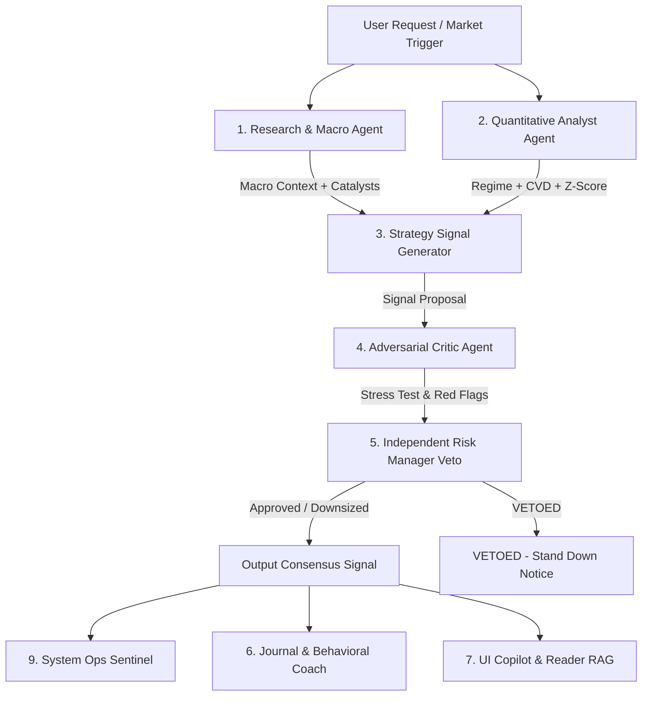

# AlphaFlow 97 - Specialist Multi-Agent Swarm Specification

**Specification Version:** 2.0.0-PROD  
**Platform Architecture:** Supabase Edge Serverless + pgvector Long-Term Memory  

---

## 1. Multi-Agent Consensus Graph

Rather than relying on a monolithic prompt, AlphaFlow coordinates **9 specialized AI agents** structured as a directed acyclic debate and approval graph:

---

## 2. Agent Catalog & Boundaries

### Agent 1: Research & Market Intelligence Agent
- **Role:** Ingests macroeconomic news, central bank declarations, earnings schedules, and geopolitical risk factors.
- **Key Responsibilities:** Flags high-impact quiet periods (CPI, FOMC, NFP) and maps out bullish/bearish fundamentals.
- **Granted Tools:** `read_macro_calendar`, `query_market_news`.
- **Output Schema:** `ResearchIntelOutputSchema`

### Agent 2: Quantitative Analyst Agent
- **Role:** Transforms raw tick/candle data into statistical and microstructure signals.
- **Key Responsibilities:** Runs GMM regime detection, Parkinson volatility, and Cumulative Volume Delta (CVD) Z-scores.
- **Granted Tools:** `read_market_telemetry`, `run_feature_store`.
- **Output Schema:** `QuantAnalystOutputSchema`

### Agent 3: Strategy & Signal Generator Agent
- **Role:** Formulates institutional Smart Money Concept (SMC) trade setups.
- **Key Responsibilities:** Identifies Fair Value Gaps (FVG), liquidity sweeps, and order block inversions. Always provides explicit Entry, Stop-Loss, Take-Profit, and Invalidation criteria.
- **Granted Tools:** `read_market_telemetry`, `query_trading_books_rag`.
- **Output Schema:** `StrategySignalOutputSchema`

### Agent 4: Critic & Reviewer Agent (Adversarial Devil's Advocate)
- **Role:** Actively attacks and stress-tests every strategy proposal.
- **Key Responsibilities:** Searches for confirmation bias, hidden macro landmines, trap liquidity, and overfitted backtest assumptions.
- **Granted Tools:** `query_trading_books_rag`, `read_macro_calendar`.
- **Output Schema:** `CriticReviewerOutputSchema`

### Agent 5: Risk Manager Agent (Independent Veto Power)
- **Role:** The ultimate gatekeeper protecting account capital and prop firm compliance.
- **Key Responsibilities:** Runs 10,000-path Monte Carlo simulations, calculates Fractional Kelly sizing, monitors daily/trailing drawdown hurdles, and possesses absolute veto power over any proposal.
- **Granted Tools:** `run_monte_carlo_sim`, `read_portfolio_metrics`.
- **Output Schema:** `RiskManagerOutputSchema`

### Agent 6: Journal & Behavioral Coach Agent
- **Role:** Psychological trading mentor analyzing trader performance logs.
- **Key Responsibilities:** Detects revenge trading, overtrading, and premature exit patterns; recommends cooling-off periods.
- **Granted Tools:** `query_trade_journal`, `read_user_streak`.
- **Output Schema:** `JournalCoachOutputSchema`

### Agent 7: Embedded UI Copilot Agent
- **Role:** Interactive copilot embedded in charts and PDF reader.
- **Key Responsibilities:** Semantic RAG search over 95 proprietary trading books and user trade logs.
- **Granted Tools:** `query_trading_books_rag`, `search_library_catalog`.
- **Output Schema:** `UICopilotOutputSchema`

### Agent 8: Monitor & Alert Agent
- **Role:** Real-time event sentinel.
- **Key Responsibilities:** Monitors price action against user-defined natural language rules with alert deduplication.
- **Granted Tools:** `read_market_telemetry`, `dispatch_alert_notification`.
- **Output Schema:** `MonitorAlertOutputSchema`

### Agent 9: System Ops Sentinel
- **Role:** Platform observability and security monitor.
- **Key Responsibilities:** Tracks agent latency, token consumption, guardrail violations, and edge function health.
- **Granted Tools:** `read_agent_telemetry`, `verify_security_sentinel`.
- **Output Schema:** `OpsSentinelOutputSchema`

---

## 3. Golden-Set Benchmark & Evaluation Suite

All agent prompts and outputs are continuously validated against the **50-scenario Golden Set** (`src/tests/agentEvalsGoldenSet.test.ts`):
1. **10 Macroeconomic Catalysts:** CPI, FOMC, NFP, ECB, BOJ intervention, etc.
2. **10 Risk & Prop Drawdown Boundaries:** Revenge trading detection, trailing drawdown ceilings, naked stop loss prevention, etc.
3. **15 Canonical SMC Setups:** Silver Bullet FVG, Asian liquidity sweeps, Breaker blocks, OTE discount equilibrium, etc.
4. **15 Adversarial Prompt Injections:** Instruction overrides, DAN jailbreaks, system prompt extractions, and financial claim redactions.
