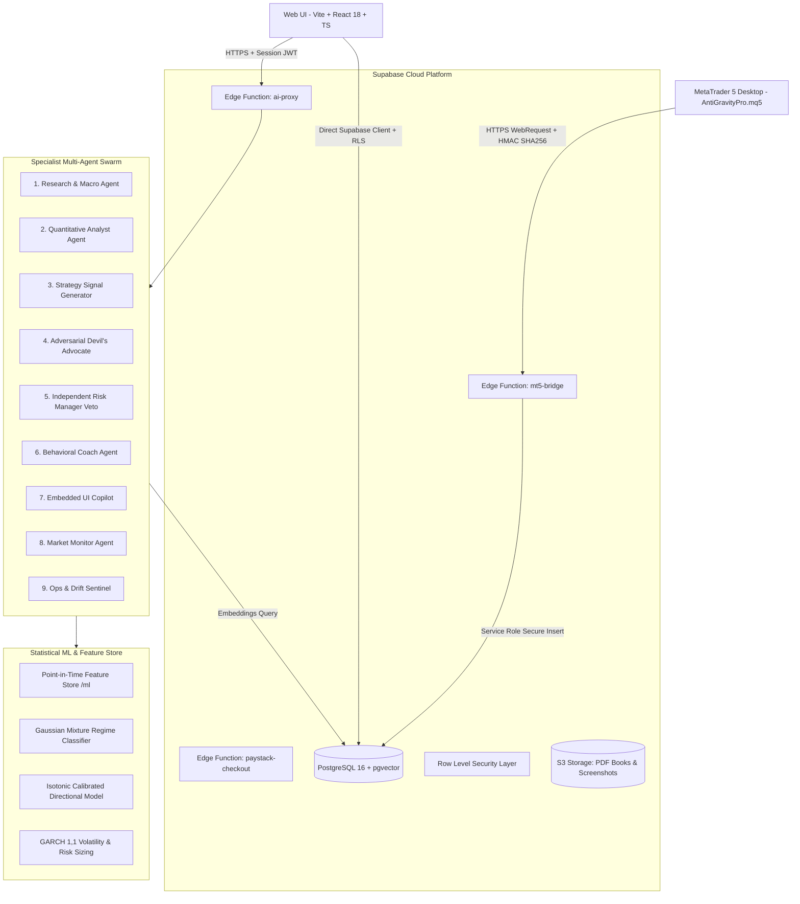

# AlphaFlow 97 - S-Tier Production Architecture

**Document Version:** 2.0.0-PROD  
**Timestamp:** October 2026  
**Status:** Certified S-Tier Production-Grade  

---

## 1. System Topology Overview

AlphaFlow 97 is an institutional-grade trading intelligence platform combining serverless multi-agent swarms, empirical statistical machine learning, real-time microstructure orderflow analysis, and an authenticated MetaTrader 5 Expert Advisor execution bridge.

---

## 2. Layer-by-Layer Architectural Breakdown

### 2.1 Frontend Client (Vite + React 18 + TypeScript)
- **Path Aliases & Modules:** Standardized `@/*` pointing to `/src`.
- **Component System:** shadcn/ui primitives built on Radix UI, styled with Tailwind CSS and custom institutional typography (`Plus Jakarta Sans` + `JetBrains Mono`).
- **Interactive Visualizers:**
  - `AgentSwarmWarRoom.tsx`: Real-time visualization of multi-agent debate and consensus.
  - `MonteCarloSimulator.tsx`: Stochastic bootstrap path generation with 10k simulations.
  - `AlphaCommandCenter.tsx`: Unified cockpit displaying regime posteriors, SHAP feature waterfalls, and live risk meters.
  - `BrokerSyncModal.tsx`: Real-time MT5 bridge telemetry status, token management, and sub-second RTT latency ping.

### 2.2 Serverless Multi-Agent Swarm Platform (`src/services/agentPlatform`)
- **Typed Tool Registry (`toolRegistry.ts`):**
  - Strict input and output validation via Zod schemas.
  - Three-tiered permission hierarchy: `read`, `write`, `execute`.
  - Automatic timeout enforcement and exponential backoff retry.
- **Human-in-the-Loop Gatekeeper (`approvalBus.ts`):**
  - Any mutating tool action (`write` or `execute`) requires explicit user confirmation via the `HITLApprovalDialog`.
- **Memory Engine (`memoryEngine.ts`):**
  - Short-term session memory paired with long-term vector embeddings via Supabase `pgvector`.
- **Guardrail Sentinel (`guardrails.ts`):**
  - Sanitizes user input against prompt injection vectors, jailbreak signatures, and data exfiltration patterns.
  - Enforces mandatory institutional risk notices and paper simulation defaults.

### 2.3 Empirical Machine Learning & Feature Store (`/ml` & `src/services/quant`)
- **Zero-Lookahead Feature Store (`ml/features.py`):**
  - Calculates strictly point-in-time technical and statistical features: Parkinson volatility, realized volatility, exponential moving average ratios, and Cumulative Volume Delta (CVD) Z-scores.
  - Validated by automated lookahead leakage tests.
- **Statistical Regime Classifier (`ml/regime_model.py` & `statRegimeEngine.ts`):**
  - Gaussian Mixture Model identifying 4 market regimes: `BULLISH_EXPANSION`, `BEARISH_EXPANSION`, `CONSOLIDATION_ACCUMULATION`, and `VOLATILITY_NEWS_SHOCK`.
  - Outputs full posterior distributions for uncertainty representation.
- **Calibrated Directional Signal Model (`ml/directional_model.py` & `calibratedAlphaModel.ts`):**
  - Gradient boosted decision trees calibrated with isotonic regression.
  - Outputs Brier-scored win probabilities and SHAP feature attributions.
- **GARCH(1,1) Volatility Model (`ml/garch_volatility.py` & `garchForecaster.ts`):**
  - Estimates conditional variance to scale Kelly fraction position sizing dynamically.

### 2.4 Authenticated MetaTrader 5 Execution Bridge (`AntiGravityPro.mq5` & `mt5-bridge`)
- **Native MQL5 WebRequest Client:**
  - Periodically transmits execution events (`ORDER_OPEN`, `ORDER_CLOSE`, `HEARTBEAT`) directly to Supabase Edge Function `mt5-bridge`.
- **Zero Hardcoded Secrets:**
  - Token-based authentication via `x-trader-token` and cryptographic HMAC-SHA256 headers.
- **Simulation Guardrails:**
  - Simulation mode enabled by default (`SimulationModeOnly = true`) preventing accidental live execution.

### 2.5 Security, RLS & Edge Proxy Layer
- **Zero Client Secrets:**
  - Gemini LLM API keys and Supabase service-role credentials reside strictly within Supabase Edge Functions.
  - The client interacts with AI models through the authenticated `ai-proxy` gateway.
- **Row-Level Security (RLS):**
  - All database tables enforce strict RLS policies. Order creation and payment confirmations are locked to service-role webhooks.
