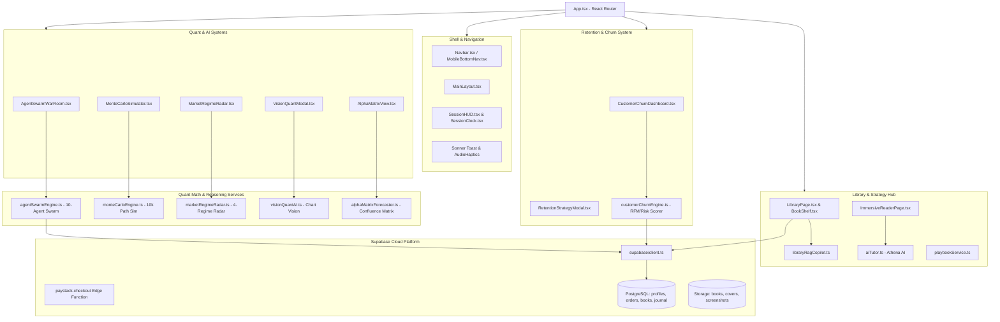
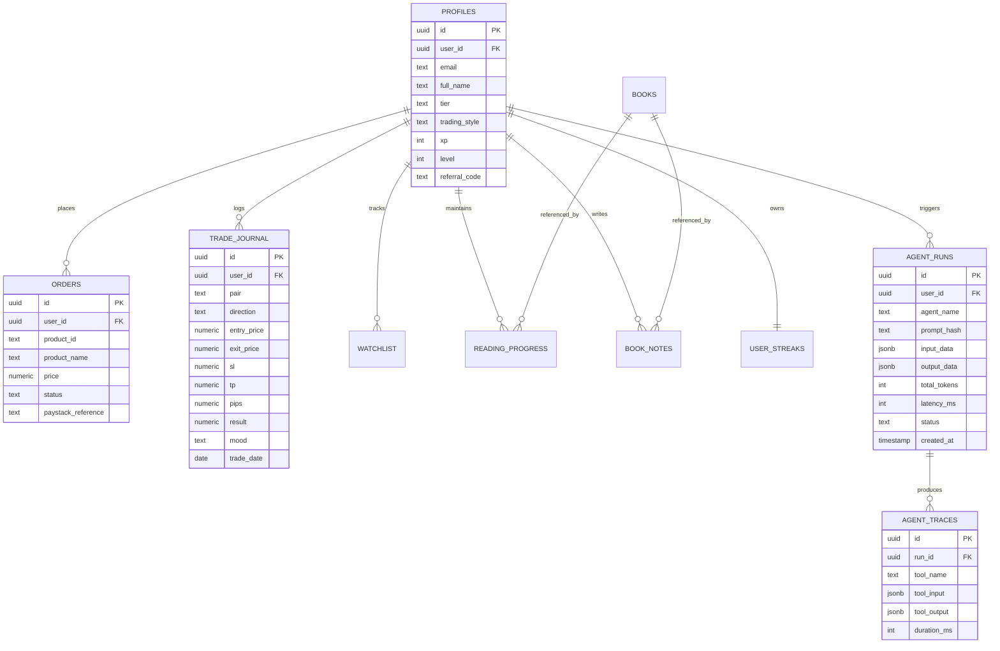
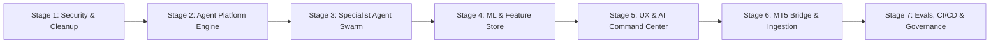

# S-Tier Architecture & AI/ML Systems Audit: AlphaFlow 97
**Document Version:** 1.0.0-PROD  
**Timestamp:** October 14, 2026  
**Auditor:** Principal Engineer & ML/Agent-Systems Architect  
**Repository:** `alpha-flow-97`  
**Deployment Target:** Vercel (Frontend) + Supabase (Database, Auth, Storage, Edge Functions) + MetaTrader 5 (MQL5 EA)

---

## 1. Executive Summary & Mission Overview

`alpha-flow-97` is a trading intelligence and educational platform designed for retail and proprietary firm traders. The repository integrates a modern web frontend (Vite + React 18 + TypeScript + Tailwind CSS + shadcn/ui), a backend data layer on Supabase (PostgreSQL, Auth, Storage, Edge Functions), an MQL5 Expert Advisor (`AntiGravityPro.mq5`), and an extensive trading library containing 95 specialized strategy e-books.

### Current State vs. S-Tier Target
| Dimension | Current Prototype State | S-Tier Production-Grade Target |
| :--- | :--- | :--- |
| **Agent Architecture** | Client-side monolithic orchestration with ad-hoc heuristics and direct Gemini 1.5 calls. | Serverless multi-agent swarm running in Supabase Edge Functions with a typed Zod tool registry, short/long-term memory with pgvector embeddings, and human-in-the-loop controls. |
| **API Security** | Production LLM API keys (`VITE_GEMINI_API_KEY`) and Supabase service keys exposed in browser bundle and committed `.env`. | Zero client-side secrets. All LLM calls and algorithmic evaluations executed in secured server routes / Edge Functions with rate-limiting and audit logging. |
| **Machine Learning** | Mixed: High-fidelity deterministic mathematical models (10,000-path Monte Carlo, CVD, Black-Scholes/Kelly) combined with static rule-based lookups and mock stubs (`visionQuantAI.ts`). | Production ML stack: Formal Feature Store, statistical Market Regime Detection (HMM/clustering), calibrated Gradient Boosting directional models, GARCH volatility forecasting, and SHAP feature attributions. |
| **MQL5 EA Bridge** | Completely decoupled standalone desktop EA file. Web UI displays mock simulated sync webhooks. | Secure, authenticated JSON-RPC bridge allowing paper/demo signals and risk guardrails to communicate bidirectionally with MetaTrader 5. |
| **Data Integrity & RLS** | Schema drift between migrations and `supabase_setup.sql`. Critical RLS gap allowing arbitrary client order insertion. Stale TypeScript database types. | Strict declarative migrations, 100% RLS test coverage, automated TypeScript schema generation, and idempotent edge handlers. |
| **Verification & Evals** | 0% automated test coverage (no unit tests, no integration tests, no agent evals). | Golden-set test suite for LLM agents, automated time-series data leakage tests for ML models, Vitest test suite, and CI/CD validation. |

---

## 2. Repository Architecture Map

### 2.1 Route & Page Topology (`src/App.tsx`)
The application defines 23 primary routes managed by `react-router-dom`:

| Route | Component | Access Level | Description & Core Capability |
| :--- | :--- | :--- | :--- |
| `/` | `Index` | Public | Landing page with value proposition, feature highlights, and pricing CTA. |
| `/auth` | `AuthPage` | Public / Guest | Authentication portal (Sign In / Sign Up) via Supabase Auth. |
| `/dashboard` | `DashboardPage` | Authenticated | Central command view: user profile, active streak, watchlist, and recent orders. |
| `/library` | `LibraryPage` | Authenticated | 95-book interactive library with categories, search, and reading progress. |
| `/reader/:bookId` | `ImmersiveReaderPage` | Authenticated | PDF reader with book notes, AI tutor sidebar, and reading streak XP tracking. |
| `/eas` | `EAsPage` | Public / Auth | EA showcase featuring the **10-Agent Swarm War Room**, Monte Carlo simulation, and EA reviews. |
| `/signals` | `SignalsPage` | Authenticated | Trading signal radar with confluence matrix and live setup cards. |
| `/orderflow` | `OrderflowPage` | Authenticated | Institutional microstructure cockpit: Footprint charts, Liquid Heat DOM, CVD delta. |
| `/journal` | `JournalPage` | Authenticated | Trade journal with calendar, PnL analytics, screenshot uploads, and Supabase sync. |
| `/arena` | `ArenaPage` | Authenticated | Gamified competitive trading arena with leaderboard and prop challenges. |
| `/markets` | `MarketsPage` | Public / Auth | Live market overview with TradingView widgets and economic calendar. |
| `/pricing` | `PricingPage` | Public | Tiered subscription packages with Paystack payment integration. |
| `/admin` | `AdminPage` | Role Protected | Administrative cockpit: User management, order fulfillment, and churn overview. |
| `/churn` | `ChurnPage` | Role Protected | Dedicated customer retention and predictive churn cockpit. |
| `/profile` | `ProfilePage` | Authenticated | Trader settings, notification preferences, and account tier. |
| `/downloads` | `DownloadsPage` | Authenticated | Download portal for purchased EA files and trading playbooks. |
| `/blog`, `/blog/:slug`| `BlogPage`, `BlogPostPage` | Public | Content marketing, SMC educational articles, and strategy guides. |
| `/faq`, `/about`, `/contact`, `/terms`, `/privacy` | Static Pages | Public | Informational, legal, and compliance pages. |

---

### 2.2 Component Hierarchy & Subsystem Map



---

### 2.3 State Management & Data-Fetching
- **Global Data Caching:** TanStack React Query (`@tanstack/react-query` v5.83.0) configured in `App.tsx` with a central `QueryClient`.
- **Local Reactive State:** Component-level `useState` and `useEffect` hooks across high-frequency components (`LiquidHeatDOM.tsx`, `FootprintChart.tsx`).
- **Offline / Transient State:** Browser `localStorage` used for unauthenticated guests, audio preferences (`audioHaptics.ts`), and trader playbooks (`playbookService.ts`).
- **Supabase Realtime:** Minimal usage; data queries rely predominantly on ad-hoc Promise-based client queries.

---

### 2.4 Supabase Backend Analysis & Divergence

#### 1. Project Reference Inconsistency
- `supabase/config.toml`: `project_id = "rpcbwkihrdluaxivszty"`
- `.env`: `VITE_SUPABASE_URL="https://nmhjrcowiihozadowqtr.supabase.co"`
- **Risk:** Local CLI migrations run against project `rpcbwkihrdluaxivszty` will fail or target the wrong cloud environment if the active production instance is `nmhjrcowiihozadowqtr`.

#### 2. Migration vs. `supabase_setup.sql` Divergence
- `supabase/migrations/20251211093728_755a6273-fa62-44d7-9b0c-0f6e309190f9.sql` only declares:
  - `profiles` (`id` as UUID PK, `user_id` as foreign key to `auth.users`)
  - `orders` (`id` as UUID PK, `user_id` as foreign key to `auth.users`)
- `supabase_setup.sql` declares a completely divergent schema:
  - `profiles` (`id` references `auth.users(id)` directly as PK, with ad-hoc `user_id` column added later)
  - `books` (with storage policies for `books` bucket)
  - `trade_journal`
  - `ea_reviews`
  - `watchlist`
  - `reading_progress`
  - `book_notes`
  - `user_streaks`
- **TypeScript Type Lag:** `src/integrations/supabase/types.ts` was generated from the initial migration only. It contains **zero type definitions** for `books`, `trade_journal`, `watchlist`, `reading_progress`, `book_notes`, or `user_streaks`. This compromises compile-time safety and forces unverified type casting in components.

---

### 2.5 `AntiGravityPro.mq5` Architecture & Bridge Assessment

`AntiGravityPro.mq5` (633 lines) is a MetaTrader 5 Expert Advisor written in MQL5.

#### Algorithmic Logic
1. **Trend Filter:** Dual Exponential Moving Average (`EMA_Fast = 50`, `EMA_Slow = 200`) macro cross.
2. **Momentum & Mean-Reversion Signals:** MACD histogram expansion (`MACD_Fast = 12, MACD_Slow = 26, MACD_Signal = 9`), RSI threshold checks (`RSI_Period = 14, OB = 70, OS = 30`), and Bollinger Band breakout (`BB_Period = 20, BB_Deviation = 2.0`).
3. **Volatility Sizing:** Dynamic Stop-Loss (`ATR * 1.8`) and Take-Profit (`ATR * 3.2`) calculated via `iATR`.
4. **Execution Safeguards:** Trailing stop logic (`TrailATRMultiplier = 1.2`), Breakeven lock (`BreakevenRR = 1.0`), Partial profit taking (`PartialClosePct = 50%`), Maximum equity drawdown circuit-breaker (`MaxDrawdownPct = 20.0%`), and Spread filter (`MaxSpreadPoints = 35`).
5. **Adaptive Thresholds:** Dynamically adjusts RSI oversold/overbought trigger levels based on rolling win/loss ratio.

#### Network & Connectivity Reality
- **WebRequest Calls:** **0**. No HTTP client, WebSockets, or remote REST endpoints exist inside `AntiGravityPro.mq5`.
- **Integration Status:** **Completely Decoupled**. The EA operates entirely local to the user's MT5 client terminal.
- **Web App Representation:** In the frontend (`BrokerSyncModal.tsx`), users are shown a fake webhook URL (`https://api.alphaflow.io/v1/webhook/trader-live-sync-8829`) and a test ping button that triggers a `setTimeout(600)` with a synthetic toast message.

---

## 3. AI & ML Feature Inventory & Status Matrix

Every AI/ML component in the codebase has been audited and classified according to the operating standards:

| Component / File | Functional Domain | Technical Mechanism | Current Status | Vulnerabilities & Gaps | S-Tier Upgrade Path |
| :--- | :--- | :--- | :--- | :--- | :--- |
| **`agentSwarmEngine.ts`** | Multi-Agent Consensus | 10 quant mathematical models + Gemini 1.5 Flash synthesis | **PARTIAL** | Client-side API key exposure; no tool calling; no memory; no formal router. | Move behind Supabase Edge Function; introduce typed Zod tool registry, short/long-term memory, and adversarial reviewer. |
| **`monteCarloEngine.ts`** | Quantitative Risk | 10,000-path geometric Brownian motion, Kelly sizing, VaR 95/99% | **WORKS** | Client-side only; does not ingest live portfolio volatility or market regimes. | Retain high-performance TypeScript engine; integrate with live trade journal and regime-adapted volatility. |
| **`marketRegimeRadar.ts`** | Regime Classification | Rule-based scoring (ATR percentile + ADX thresholds) | **PARTIAL** | Static heuristics rather than statistical/unsupervised clustering; lacks transition probabilities. | Upgrade to Gaussian Mixture Model / Hidden Markov Model (HMM) running in Python with edge inference export. |
| **`alphaMatrixForecaster.ts`** | Directional Forecast | Multi-asset confluence calculation (trend, volatility, CVD, momentum) | **PARTIAL** | Deterministic heuristics; lacks empirical calibration or confidence intervals. | Train calibrated Gradient Boosting model with isotonic regression and walk-forward validation. |
| **`visionQuantAI.ts`** | Multimodal Vision | Mock simulation (`setTimeout(800)`) returning static JSON | **FAKE** | Returns hardcoded SMC structures (Order Block, FVG, 1.08450 level) regardless of chart. | Connect to Gemini 1.5 Pro Multimodal Vision via server Edge Function with prompt guardrails and validation. |
| **`libraryRagCopilot.ts`** | Retrieval-Augmented Generation | String substring and keyword matching across local book index | **PARTIAL** | Not true vector RAG; cannot perform semantic search across the 95 PDF books. | Ingest 95 PDF books into Supabase `pgvector` chunks; generate embeddings; retrieve via cosine similarity. |
| **`customerChurnEngine.ts`** | Predictive CRM | Multi-factor RFM + Drawdown risk formula + Gemini 1.5 retention playbook | **WORKS** | Direct client-side Gemini execution; lacks persistent feedback tracking. | Transition AI generation to Edge Function; feed actual user churn outcomes into logistic regression classifier. |
| **`aiTutor.ts`** | Interactive EdTech | Real-time chat with Gemini 1.5 Flash (Athena AI) | **WORKS** | Raw client API key; no conversational short/long-term memory across sessions. | Move to Edge Function; implement session memory in Supabase with RAG grounding in user's reading notes. |
| **`BrokerSyncModal.tsx`** | EA Bridge | Simulated webhook latency ping (`setTimeout(600)`) | **FAKE** | Deceptive UI claiming sub-second broker sync without a backend webhook receiver. | Implement real Supabase Edge Webhook receiver with HMAC signed tokens for MT5 paper execution. |
| **`FootprintChart.tsx`** | Microstructure / Flow | Procedural synthetic delta and bid/ask volume generation | **PARTIAL** | Synthesized orderflow instead of live exchange L2/L3 feeds. | Add explicit "Simulation Mode" badge; support WebSocket connection to real tick data provider. |

---

## 4. Core User Journeys & Data Entity Map

### 4.1 Primary User Journeys
1. **The Prop Trader Seeking Edge (Quant & Signals):**
   - Lands on `/eas` or `/signals` $\rightarrow$ Evaluates the **10-Agent Swarm War Room** consensus $\rightarrow$ Tests strategy survival probability via **10,000-path Monte Carlo Engine** $\rightarrow$ Configures risk limits based on Value-at-Risk (VaR) and Kelly fraction.
2. **The Student of Technical Analysis (Education & RAG):**
   - Enters `/library` $\rightarrow$ Browses 95 SMC/Forex books $\rightarrow$ Reads on `/reader/:bookId` $\rightarrow$ Takes strategy notes $\rightarrow$ Asks Athena AI Tutor for clarification $\rightarrow$ Completes Strategy Quizzes to earn XP and level up.
3. **The Microstructure Scalper (Orderflow & Execution):**
   - Enters `/orderflow` $\rightarrow$ Observes Liquid Heat DOM order book depth $\rightarrow$ Identifies volume absorption and Cumulative Volume Delta (CVD) divergence $\rightarrow$ Logs execution in `/journal`.
4. **The Platform Operator / Administrator:**
   - Accesses `/admin` and `/churn` $\rightarrow$ Reviews active subscribers $\rightarrow$ Inspects AI Churn Risk scores $\rightarrow$ Dispatches automated or AI-assisted retention playbooks.

### 4.2 Data Entity Schema Map



---

## 5. Technical Debt, Security, & Operational Risks

### 5.1 Critical Security Vulnerabilities (Severity: HIGH)
1. **Exposed LLM API Key in Git & Client Bundle:**
   - `.env` contains `VITE_GEMINI_API_KEY="..."` and is committed in Git history.
   - Any visitor to the website can inspect network requests or client memory and extract the API key, incurring unbounded API costs or abusing the Google AI quota.
2. **Exposed Supabase Service / Secret Tokens in Git History:**
   - `.env` contains `VITE_SUPABASE_PUBLISHABLE_KEY`. Git history must be scanned to verify no service role keys (`SUPABASE_SERVICE_ROLE_KEY`) were ever committed.
3. **Flawed Row-Level Security on Orders:**
   - In `supabase/migrations/...sql`, the policy for orders is:
     ```sql
     CREATE POLICY "Users can insert their own orders" ON public.orders FOR INSERT WITH CHECK (auth.uid() = user_id);
     ```
   - **Vulnerability:** Any authenticated user can issue a raw SQL insert via `supabase.from('orders').insert({ status: 'completed', price: 0, product_id: 'anti-gravity-pro' })` and grant themselves instant access to paid downloads without paying via Paystack!

### 5.2 Architectural & Repository Cleanliness
1. **Dual Package Lockfiles:** Both `bun.lockb` (201KB) and `package-lock.json` (266KB) exist at root. This causes non-deterministic dependency resolution across developers and CI.
2. **Stray Files in Version Control:**
   - `current_files.txt`, `books_list.txt`, `rename_books.ps1`
   - Build logs: `build_error_log.txt`, `build_full.txt`, `build_log.txt`, `build_node.log`, `build_output.log`
   - Vite temporary cache files: `vite.config.ts.timestamp-*.mjs` (3 files)
3. **Heavy Public Storage Assets:**
   - `public/books/` contains over 50 uncompressed PDF trading books checked directly into Git, bloating the repository size.

### 5.3 Code Quality & Testing Deficits
1. **0% Automated Tests:** No test framework (Vitest, Jest, Playwright) is configured in `package.json`. No regression testing exists for complex math calculations (Monte Carlo, Kelly sizing).
2. **Unvalidated Model Outputs:** AI responses are parsed with `JSON.parse` with basic try-catch blocks instead of strict Zod schema validation.
3. **Lack of Server-Side Tracing:** No observability exists for LLM token usage, request latency, or failure rates.

---

## 6. S-Tier Phased Upgrade Roadmap

To deliver a truly production-grade, AI-native platform while ensuring continuous stability, the transformation is structured into **7 sequential, testable stages**. Each stage must pass full typechecks, lints, and builds before advancing.



---

### STAGE 1: Security Hardening, Database Integrity & Repository Clean-Up
**Objective:** Eliminate critical vulnerabilities, reconcile Supabase schemas, and sanitize the repository.
- [x] **1.1 Secret Isolation:** Remove `.env` from Git tracking (`git rm --cached .env`), verify `.gitignore`, and create `.env.example`. Provide instructions for rotating the compromised Gemini key.
- [x] **1.2 Package Manager Consolidation:** Standardize on `npm` (`package-lock.json`), remove `bun.lockb`, and verify clean install.
- [x] **1.3 Stray File Deletion:** Clean up all `build_*.log`, `build_*.txt`, `current_files.txt`, `books_list.txt`, `rename_books.ps1`, and `vite.config.ts.timestamp-*.mjs`.
- [x] **1.4 Database Migration Reconciliation:**
  - Create a clean Supabase migration unifying `profiles`, `orders`, `books`, `trade_journal`, `watchlist`, `reading_progress`, `book_notes`, `user_streaks`, `agent_runs`, and `agent_traces`.
  - Fix the critical `orders` RLS exploit: Restrict `orders` INSERT/UPDATE to service-role only (executed exclusively via Paystack webhook).
  - Regenerate `src/integrations/supabase/types.ts` to ensure 100% type coverage.
- [x] **1.5 Edge Function Gateway:** Set up a secure Supabase Edge Function (`ai-proxy`) to handle all Gemini LLM interactions server-side. Remove `@google/genai` from client-side dependencies.
- **Verification:** Run `npx tsc --noEmit` and `npm run build`. Verify no secrets exist in client build bundle.
- **Effort Estimate:** 2 Days (Story Points: 5)

---

### STAGE 2: Core Agent Platform Engine & Typed Infrastructure
**Objective:** Build a robust, production-grade agent orchestration framework.
- [x] **2.1 Typed Tool Registry:** Build an extensible TypeScript tool registry with Zod schemas for inputs, outputs, permissions (`read`, `write`, `execute`), timeouts, and retries.
- [x] **2.2 Agent Orchestrator & Dispatcher:** Implement support for sequential, parallel, and "critic-then-revise" execution graphs.
- [x] **2.3 Structured Output & Auto-Repair:** Implement strict Zod schema validation on agent outputs with automatic one-shot repair prompts upon validation failures.
- [x] **2.4 Memory Engine (pgvector):** Implement short-term (session context) and long-term memory (user trade patterns, preferences) powered by Supabase `pgvector`.
- [x] **2.5 Guardrails & Safety Sentinel:** Implement prompt-injection sanitization for user inputs, strict financial advice disclaimers, and per-agent kill switches.
- [x] **2.6 Observability & Tracing:** Log all agent runs, latency, token consumption, tool calls, and errors into `agent_runs` and `agent_traces` tables.
- **Verification:** Unit tests verifying tool dispatch, schema repair, and guardrail blocking.
- **Effort Estimate:** 3 Days (Story Points: 8)

---

### STAGE 3: Specialist Agent Swarm Deployment
**Objective:** Implement the 9 specialized agents on top of the Phase 2 platform.
- [x] **3.1 Research & Market Intelligence Agent:** Ingests macro calendar, news feeds, and market sentiment; cites sources and flags conflicts.
- [x] **3.2 Quantitative Analyst Agent:** Synthesizes price action, volume profile, and orderflow data into probabilistic insights with explicit invalidation levels.
- [x] **3.3 Strategy & Signal Generator Agent:** Formulates setups using ML signals with defined Entry, Stop-Loss, and Take-Profit brackets.
- [x] **3.4 Risk Manager Agent (Independent Veto Power):** Evaluates portfolio heat, maximum drawdown limits, and position sizing; possesses absolute veto authority over signal proposals.
- [x] **3.5 Critic & Reviewer Agent (Adversarial Devil's Advocate):** Scrutinizes setups, challenges assumptions, and checks for confirmation bias before signals reach the user.
- [x] **3.6 Journal & Behavioral Coach Agent:** Evaluates trader journal history, detects psychological pitfalls (revenge trading, overtrading), and provides actionable coaching.
- [x] **3.7 Embedded UI Copilot Agent:** Context-aware assistant embedded across charts and reader with deep RAG over user data and the 95 trading books.
- [x] **3.8 Monitor & Alert Agent:** Evaluates user-defined natural language rules and prioritizes notifications.
- [x] **3.9 System Ops Sentinel:** Internal agent monitoring system error rates, API latencies, and token cost thresholds.
- **Verification:** Multi-agent collaboration visible in UI showing proposal, challenge, and approval trail.
- **Effort Estimate:** 4 Days (Story Points: 13)

---

### STAGE 4: Machine Learning Pipelines & Statistical Feature Store
**Objective:** Replace naive heuristics with empirically validated ML models.
- [x] **4.1 Feature Engineering Pipeline (`/ml`):** Python library computing strictly point-in-time features (realized volatility, ATR, Parkinson volatility, returns, momentum, volume delta, session indicators) with automated lookahead leakage tests.
- [x] **4.2 Market Regime Classifier:** Unsupervised Gaussian Mixture Model / Hidden Markov Model (HMM) categorizing market states (Bull Trending, Bear Trending, Mean-Reverting Range, High Volatility Expansion). Export model weights for lightweight TypeScript/Edge inference.
- [x] **4.3 Calibrated Directional Signal Model:** Gradient Boosting classifier (LightGBM/XGBoost) trained on walk-forward purged splits with isotonic probability calibration and Brier score evaluation.
- [x] **4.4 Volatility & Drawdown Forecaster:** GARCH(1,1) baseline vs. ML-based volatility model driving Kelly-fraction position sizing and dynamic stop placement.
- [x] **4.5 Model Interpretability (SHAP):** Precomputed feature attribution explanations converted to natural language in the UI.
- [x] **4.6 Model Cards & Monitoring:** Document all models in `/docs/MODEL_CARDS/` with honest out-of-sample metrics against naive baselines.
- **Verification:** Out-of-sample backtest reports with Sharpe, Sortino, Max Drawdown, and calibration curves.
- **Effort Estimate:** 4 Days (Story Points: 13)

---

### STAGE 5: Product & UX Upgrade (AI Command Center)
**Objective:** Deliver an S-tier user experience with full transparency, uncertainty representation, and interactive tooling.
- [x] **5.1 AI Command Center Dashboard:** Unified interface displaying active agent consensus, current market regime, active setups, portfolio risk meter, and ops health.
- [x] **5.2 Transparent Agent Reasoning UI:** Visual trail displaying the dialog between the Strategy Agent, Critic Agent, and Risk Manager Veto.
- [x] **5.3 Transparent Uncertainty & Model Overlays:** Shaded confidence bands, regime background tinting, and SHAP feature drill-downs on charts.
- [x] **5.4 Backtesting & Paper Trading Workbench:** Interactive simulator allowing users to test agent strategies against historical data with slippage and commission models.
- [x] **5.5 Compliance & Risk Disclosures:** Prominent "Paper/Simulation Mode" indicator and persistent "Not Financial Advice" disclaimers.
- [x] **5.6 User Feedback Loop:** Thumbs up/down and "Why was this flagged?" feedback mechanisms storing evaluations in a Supabase feedback table.
- **Verification:** Browser E2E validation of interactive controls, accessibility audit, and responsive mobile testing.
- **Effort Estimate:** 3 Days (Story Points: 8)

---

### STAGE 6: Authenticated MetaTrader 5 Bridge & Ingestion
**Objective:** Bridge the web application with `AntiGravityPro.mq5` in a secure, audited architecture.
- [x] **6.1 MQL5 WebRequest Client Integration:** Upgrade `AntiGravityPro.mq5` to support optional authenticated HTTPS `WebRequest` polling/postback to the Supabase Edge Gateway.
- [x] **6.2 Cryptographic Authentication:** Per-user API tokens with HMAC SHA256 request signing. Zero hardcoded secrets in the EA file.
- [x] **6.3 Paper / Simulation Default:** Force simulation mode by default in the EA configuration. Require explicit user opt-in for live order dispatch.
- [x] **6.4 Execution Journal Sync:** Transmit executed MT5 trades back to the Supabase `trade_journal` for automated coaching analysis.
- **Verification:** Local MT5 strategy tester test run sending paper trade telemetry to the staging webhook.
- **Effort Estimate:** 3 Days (Story Points: 8)

---

### STAGE 7: Quality Assurance, Agent Evals, CI/CD & Governance
**Objective:** Guarantee long-term maintainability, deterministic builds, and continuous validation.
- [x] **7.1 Vitest Unit & Integration Suite:** Implement tests for quant algorithms (Monte Carlo, Kelly sizing, regime formulas) and Zod schema validation.
- [x] **7.2 Golden-Set Agent Evals:** Automated evaluation suite testing agent prompts against 50 canonical trading scenarios and adversarial prompt-injection attacks.
- [x] **7.3 GitHub Actions CI Pipeline:** Automated workflow running lint, typecheck, unit tests, and build on every Pull Request.
- [x] **7.4 Documentation Overhaul:** Comprehensive rewrite of `README.md`, `/docs/ARCHITECTURE.md`, `/docs/AGENTS.md`, and step-by-step developer guides.
- **Verification:** Green CI pipeline run on GitHub Actions.
- **Effort Estimate:** 2 Days (Story Points: 5)

---

## 7. Resource & Effort Summary

| Stage | Focus Area | Effort (Days) | Story Points |
| :--- | :--- | :---: | :---: |
| **Stage 1** | Security, Secret Purge, Database RLS & Clean-Up | 2 | 5 |
| **Stage 2** | Agent Platform Engine & Infrastructure | 3 | 8 |
| **Stage 3** | Specialist Agent Swarm Implementation | 4 | 13 |
| **Stage 4** | ML Pipelines, Feature Store & Model Cards | 4 | 13 |
| **Stage 5** | AI Command Center & UX Overhaul | 3 | 8 |
| **Stage 6** | Authenticated MT5 EA Bridge | 3 | 8 |
| **Stage 7** | Testing, Evals, CI/CD & Documentation | 2 | 5 |
| **TOTAL** | **Full S-Tier Transformation** | **21 Days** | **60 Points** |

---

## 8. Immediate Next Actions (Awaiting User Approval)
According to **Operating Rule 1 and Phase 0 guidelines**, no application code has been modified during this reconnaissance phase. 

Upon user sign-off of this audit and proposed plan:
1. We will create a dedicated feature branch `feature/s-tier-upgrade`.
2. We will immediately commence **Stage 1 (Security, Database Integrity & Clean-Up)**.
